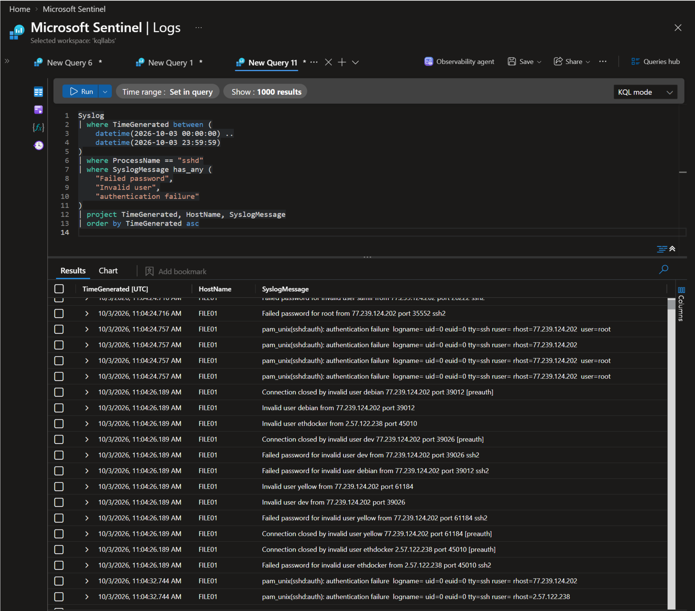
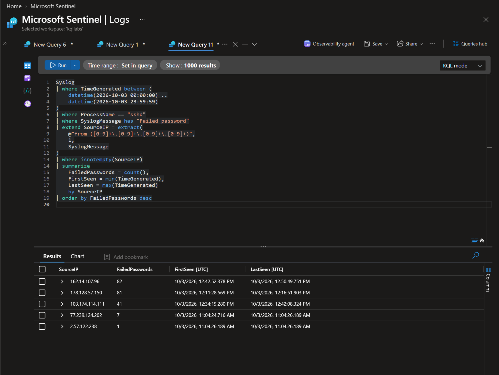
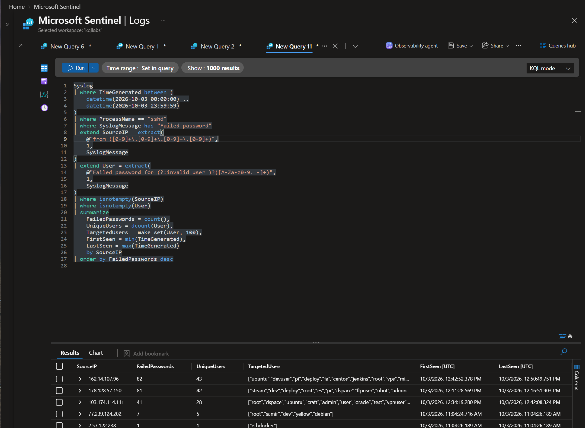
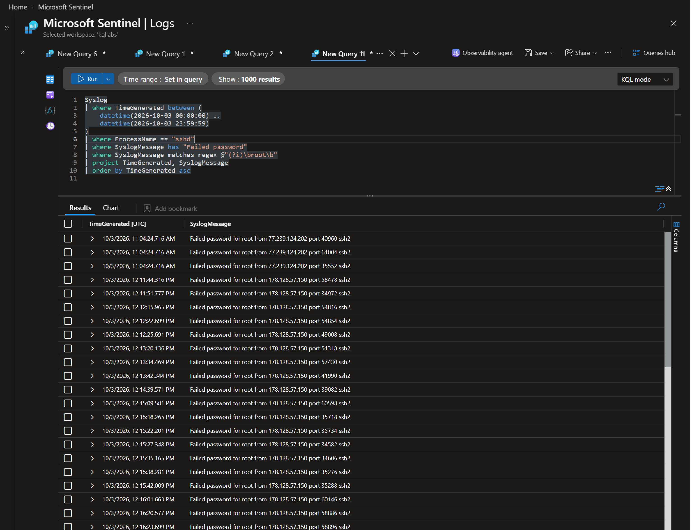
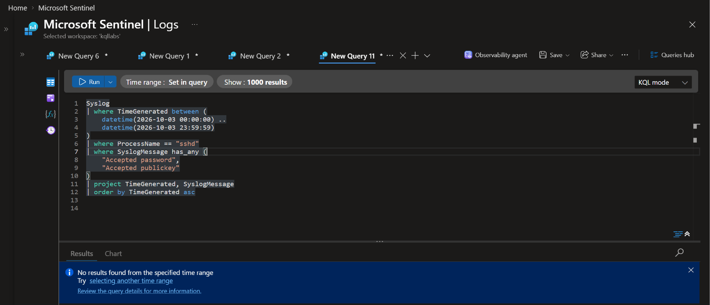

# Case 005: Real SSH Brute-Force Detection — Failed Authentication Attempts from Multiple External Sources

## 1. Executive Summary

On 3 October 2026, the Azure Linux host `FILE01` recorded repeated external SSH authentication failures involving multiple source IP addresses and usernames. Microsoft Sentinel and local host evidence were reviewed to characterize the activity and assess whether successful SSH authentication or signs of post-exploitation were observed.

The reviewed Sentinel query returned no successful SSH authentication events. No successful SSH authentication was identified in the reviewed local journal output for the investigation window. Selected host checks covered temporary directories, account and group modification evidence, systemd unit files, and the effective SSH configuration.

The evidence supports a finding of repeated external SSH password-guessing activity against an internet-exposed service. No successful SSH authentication was observed in the reviewed data; however, the available evidence is not sufficient to declare the host definitively uncompromised.

The principal hardening issue identified was SSH exposure to the internet with password authentication enabled. Recommendations include restricting inbound SSH access, disabling password authentication where feasible, and continuing targeted monitoring.

## 2. Scope and Environment

- **Target host:** `FILE01`
- **Platform:** Ubuntu Linux virtual machine hosted in Microsoft Azure
- **SIEM:** Microsoft Sentinel
- **Telemetry:** Linux Syslog / `sshd` events, local authentication logs, systemd journal, and local failed-login records
- **Investigation date:** 3 October 2026
- **Additional historical context:** Failed-login records dated 30 September 2026
- **External reputation source:** VirusTotal

The investigation used available SIEM telemetry and selected endpoint artifacts. A complete forensic disk or memory acquisition and a full historical export of Azure Network Security Group (NSG) rules were not available for this assessment.

## 3. Investigation and Evidence

### 3.1 Establish the SSH Authentication Timeline

**Objective:** Confirm and characterize SSH authentication failures on the target host.

**KQL query:** [01-authentication-evidence.kql](./queries/01-authentication-evidence.kql)



The initial query was used to establish the authentication timeline and review event source, target host, authentication outcome, timestamps, usernames, and source IP addresses.

A single failed authentication event does not establish brute-force activity. The event pattern, frequency, and distribution of attempts must be assessed together.

### 3.2 Identify External Source IPs

**Objective:** Identify source IP addresses associated with the observed failed SSH authentication events.

**KQL query:** [02-external-source-ips.kql](./queries/02-external-source-ips.kql)



The query results were used to identify source IPs for further correlation and reputation assessment.

### 3.3 Assess Source IP Reputation

**Objective:** Gather third-party reputation context for the identified source IP addresses.

The source IPs were reviewed using VirusTotal.

Screenshots:
- [VirusTotal result 1](./screenshots/04-virustotal-01.png)
- [VirusTotal result 2](./screenshots/05-virustotal-02.png)
- [VirusTotal result 3](./screenshots/06-virustotal-03.png)
- [VirusTotal result 4](./screenshots/07-virustotal-04.png)
- [VirusTotal result 5](./screenshots/08-virustotal-05.png)

**Assessment note:** Third-party reputation data provides additional context but does not independently prove that a specific connection was malicious. Record the actual detections and confidence for each IP rather than assigning the same verdict to every address.

### 3.4 Determine Targeted Usernames

**Objective:** Determine whether the observed activity targeted one username repeatedly or multiple usernames.

**KQL query:** [03-determine-how-many-accounts-each-source-targeted.kql](./queries/03-determine-how-many-accounts-each-source-targeted.kql)



The query was used to examine the distribution of failed authentication attempts across usernames and source IPs. This helps characterize the activity without assuming a specific attack technique before the evidence supports it.

### 3.5 Correlate Source IPs, Usernames, and Attempts

**Objective:** Establish the relationship between source IPs, targeted usernames, and the number of failed authentication attempts.

**KQL query:** [04-build-source-username-attempt-matrix.kql](./queries/04-build-the-source%20-username%20-attempt-matrix.kql)


The resulting matrix supports comparison of authentication activity across sources and accounts. The `root` account was reported as receiving the highest number of failed attempts in the reviewed output. Confirm the counts against the query results before publishing exact figures.

### 3.6 Investigate Attempts Against the Root Account

**Objective:** Examine the frequency, source distribution, and timing of failed authentication attempts targeting `root`.

**KQL query:** [05-investigate-username-root.kql](./queries/05-investigate-username-root.kql)



This focused analysis was used to assess activity targeting a privileged account and correlate it with the broader authentication timeline.

### 3.7 Check for Successful SSH Authentication in Sentinel

**Objective:** Determine whether successful SSH authentication was observed in the reviewed Sentinel telemetry.

**KQL query:** [06-successful-authentication.kql](./queries/06-successful-authentication.kql)



**Finding:** The query returned no successful SSH authentication events in the reviewed Sentinel telemetry.

This finding applies to the data and time range queried. It does not independently establish that the host was uncompromised.

### 3.8 Validate Authentication Findings on the Endpoint

**Objective:** Corroborate Sentinel findings using locally available authentication logs on `FILE01`.

The following command was used to review SSH-related messages in the system journal for 3 October 2026:

```bash
sudo journalctl -u ssh \
  --since "2026-10-03 00:00:00" \
  --until "2026-10-04 00:00:00" \
  --no-pager -o short-iso |
  grep -E 'sshd|Failed password|Invalid user|authentication failure'
```

To check for successful SSH authentication:

```bash
sudo journalctl -u ssh \
  --since "2026-10-03 00:00:00" \
  --until "2026-10-04 00:00:00" \
  --no-pager -o short-iso |
  grep -E 'Accepted password|Accepted publickey'
```

The original `/var/log/auth.log` search returned `grep: binary file matches` and a subsequent date-filtered search returned no output. Because log format, rotation, and file contents can affect this result, the empty output alone should not be treated as proof that no events existed. The journal queries provide a clearer time-bounded check, subject to journal retention and completeness.

**Finding:** No successful SSH authentication was identified in the reviewed local journal output for the investigation window.

The endpoint and Sentinel findings are consistent for the successful-authentication checks performed. This supports the assessment but does not prove that all events were collected without loss.

**Telemetry path:**

`FILE01 → Local Logs → Azure Monitor Agent → Log Analytics → Microsoft Sentinel`

### 3.9 Analyze Failed Authentication Patterns

**Objective:** Compare the distribution of failed authentication attempts across usernames and source IP addresses.

The local SSH journal and failed-login records were reviewed to identify targeted usernames and additional historical activity.

The reported output included common usernames such as `root`, `ubuntu`, `deploy`, `test`, `admin`, `user`, `postgres`, `oracle`, and `ubnt`. Some source IPs showed similar username-targeting patterns.

Similar patterns may be consistent with automated scanning or password guessing, but do not establish that the sources shared an operator or belonged to the same botnet. Confirm all counts and source-to-account relationships against the underlying command output before including exact numbers.


### 3.10 Review Historical Failed Login Records

**Objective:** Determine whether failed SSH authentication activity was recorded outside the primary investigation window.

**Command:**

```bash
sudo lastb -ai | head -1000
```

The `lastb` utility reads failed-login records from `/var/log/btmp`. The reviewed output reportedly included records dated 30 September 2026, involving additional source IPs and attempted usernames, including `77.239.124.202` and `2.57.122.238`.

The historical output also reportedly included activity associated with `77.239.124.151`. Validate the reported count of more than 375 attempts against the actual output before publishing it.

**Finding:** The reviewed failed-login records indicate SSH authentication attempts on multiple dates. This is consistent with recurring automated scanning or password-guessing activity against a publicly accessible SSH service. The records do not, by themselves, establish that all activity was part of one campaign or originated from a single botnet.

### 3.11 Review Successful Login History

**Objective:** Review recorded login sessions for additional context about host access.

**Command:**

```bash
sudo last -ai | head -50
```


The `last` utility reads session records from `/var/log/wtmp`. These records provide context about recorded user sessions and system boots, but do not replace SSH authentication logs when assessing successful SSH access.

**Finding:** Document the sessions and boot records visible in the reviewed output. Do not use `last` alone to conclude that no successful SSH authentication occurred.

### 3.12 Inspect Temporary Directories

**Objective:** Search common temporary directories for artifacts that could be associated with suspicious execution or staging activity.

**Commands:**

```bash
ls -la /tmp /var/tmp /dev/shm
```
```bash
sudo find /tmp /var/tmp /dev/shm \
  -mtime -3 -ls 2>/dev/null
```


**Finding:** No suspicious artifacts were identified in `/tmp`, `/var/tmp`, or `/dev/shm` during the reviewed inspection, according to the recorded assessment.

This finding is limited to the directories and files examined. The `-mtime -3` filter is relative to the time the command was run and does not necessarily represent the three days preceding the 3 October investigation window.

### 3.13 Review Account and Group Modification Evidence

**Objective:** Search available authentication logs for entries related to local account, group, or password management.

**Command:**

```bash
sudo grep -a -E \
'useradd|usermod|userdel|passwd|groupadd|gpasswd' \
/var/log/auth.log
```

**Finding:** No matching entries establishing unexpected account or group modifications were identified in the reviewed output.

This string-based search does not comprehensively audit all account changes and cannot prove that no modifications occurred. Its scope is limited to matching records in the available log file.

### 3.14 Inspect systemd Persistence Locations

**Objective:** Review enabled systemd unit files, failed units, and locally defined service files for potentially suspicious persistence.

**Commands:**

```bash
systemctl list-unit-files --state=enabled
systemctl --failed
```

```bash
sudo find /etc/systemd/system \
  -maxdepth 3 -type f -ls
```


The review focused on unexpected services or timers, suspicious execution commands, and references to unusual script or binary locations.

**Finding:** No suspicious systemd persistence artifacts were reported in the reviewed unit files and command output. This conclusion is limited to the inspected locations and service information; it does not exclude other persistence mechanisms.

### 3.15 Review Effective SSH Configuration

**Objective:** Determine which SSH daemon settings affect remote access and password-based authentication.

**Command:**

```bash
sudo sshd -T | grep -E \
'port|permitrootlogin|passwordauthentication|pubkeyauthentication|maxauthtries|logingracetime|allowusers|allowgroups'
```


The recorded configuration assessment reported the following values. Verify each value against the actual command output before publishing:

- `port 22`
- `passwordauthentication yes`
- `permitrootlogin without-password`
- `maxauthtries 6`
- `logingracetime 120`

**Assessment:** Password authentication was enabled, and SSH was reachable from the internet through an Azure Network Security Group during the relevant exposure period, according to the available investigation context. This configuration increased exposure to automated password-guessing attempts.

The observed `permitrootlogin without-password` setting disables password-based SSH login for `root` while permitting public-key authentication, subject to the effective configuration. If this setting was active during the observed activity, password-based attempts targeting `root` should have been rejected by the SSH authentication policy.

The current configuration output does not, by itself, establish the exact configuration that was active at the time of every event.

## 4. Compromise Assessment

Based on the reviewed evidence:

- Multiple external IP addresses generated failed SSH authentication attempts against `FILE01`.
- Several usernames were targeted, including privileged and commonly used account names.
- No successful SSH authentication was observed in the reviewed Sentinel telemetry, and none was identified in the reviewed local journal output for the investigation window.
- Historical failed-login records indicate additional SSH authentication activity on earlier dates.
- The reviewed checks did not identify suspicious artifacts in the inspected temporary directories or systemd unit locations.
- The available string-based log search did not identify unexpected account or group modification entries.
- SSH password authentication was enabled, increasing exposure to password-guessing attempts.

The available evidence does not establish successful compromise. However, the scope of the reviewed telemetry and host artifacts is insufficient to declare the host definitively uncompromised.

## 5. Conclusion and Recommendations

### Conclusion

The investigation identified repeated external SSH authentication failures against an internet-exposed Azure Linux host. The observed activity is consistent with automated SSH scanning and password guessing. No successful SSH authentication was observed in the reviewed Sentinel telemetry or identified in the reviewed local journal output.

The principal hardening issue identified was public SSH exposure combined with password authentication enabled. The observed root-login restriction reduced the risk of password-based SSH access to `root`, provided that the setting was effective during the relevant period.

This assessment is limited to the available logs, selected host artifacts, and configuration evidence. A complete forensic disk or memory acquisition and a full historical export of NSG rules were not available to establish every aspect of host state and historical exposure.

### Recommendations

1. **Restrict SSH exposure:** Limit inbound TCP/22 in Azure NSG rules to trusted source IPs or an approved management path, such as VPN or Azure Bastion, where appropriate.
2. **Harden authentication:** Disable SSH password authentication where operationally feasible and use approved SSH key-based authentication.
3. **Validate privileged access:** Review local accounts, authorized SSH keys, sudo privileges, and relevant authentication records for unexpected access.
4. **Continue targeted monitoring:** Maintain Microsoft Sentinel detections for failed and successful SSH authentication, unusual username patterns, and activity from recurring sources.
5. **Apply IP blocking selectively:** Consider blocking validated malicious sources based on supporting evidence and operational impact. Do not block an entire subnet solely because one address in that range was observed.
6. **Verify telemetry coverage:** Confirm log retention, Azure Monitor Agent collection, timestamp consistency, and ingestion completeness for relevant SSH events.

## 6. Evidence Limitations

- The assessment depends on the telemetry and host artifacts available during the review.
- Empty query results do not prove that an event never occurred; results depend on query logic, time range, retention, and data collection.
- VirusTotal reputation is contextual intelligence and does not independently prove that a particular connection was malicious.
- Similar source-IP behavior does not establish common ownership or botnet affiliation.
- The exact timing of historical NSG changes was not established from a complete historical configuration export.
- The investigation did not include a complete forensic disk or memory acquisition.
