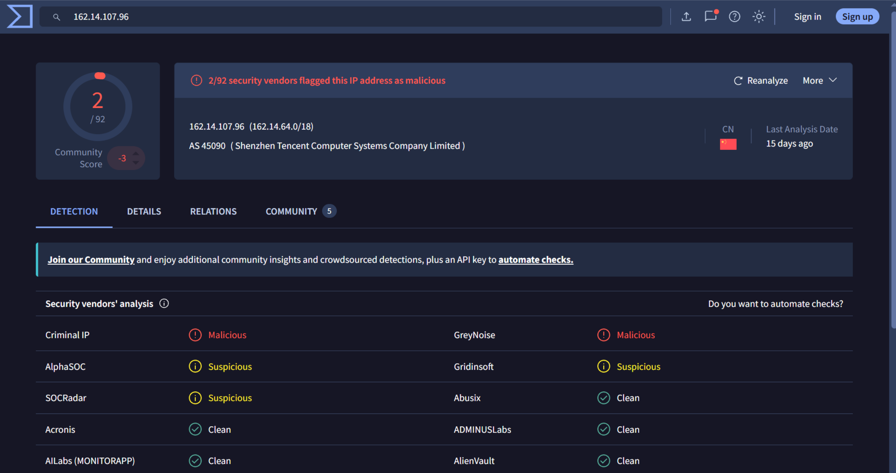
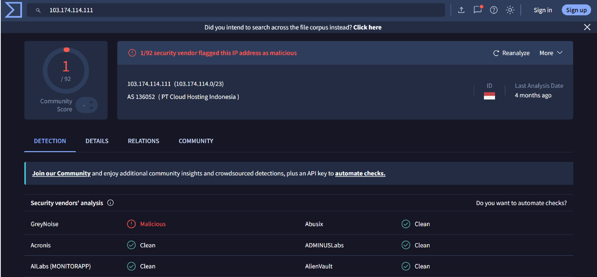
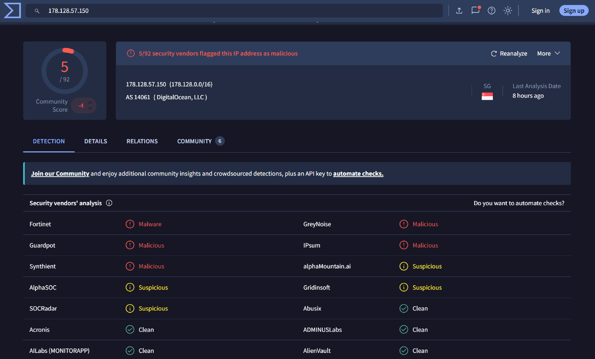
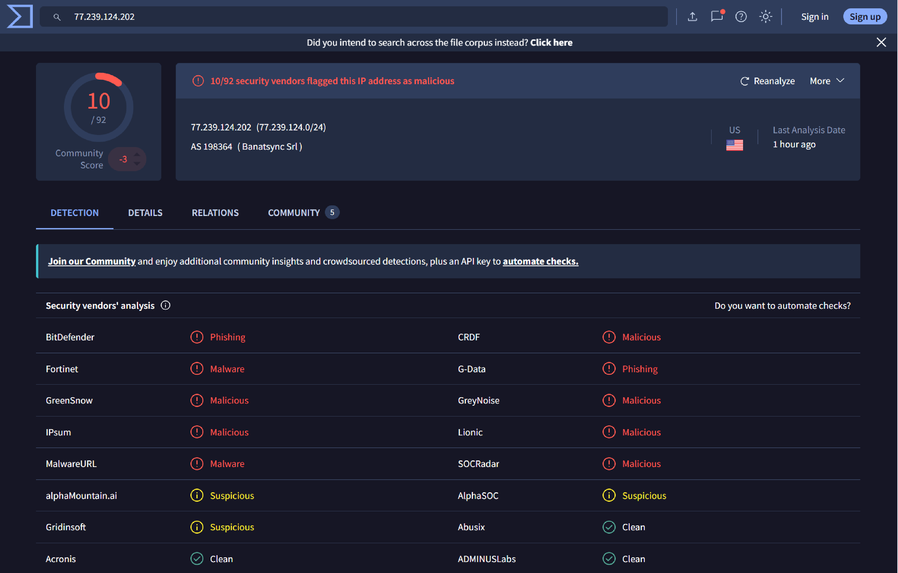
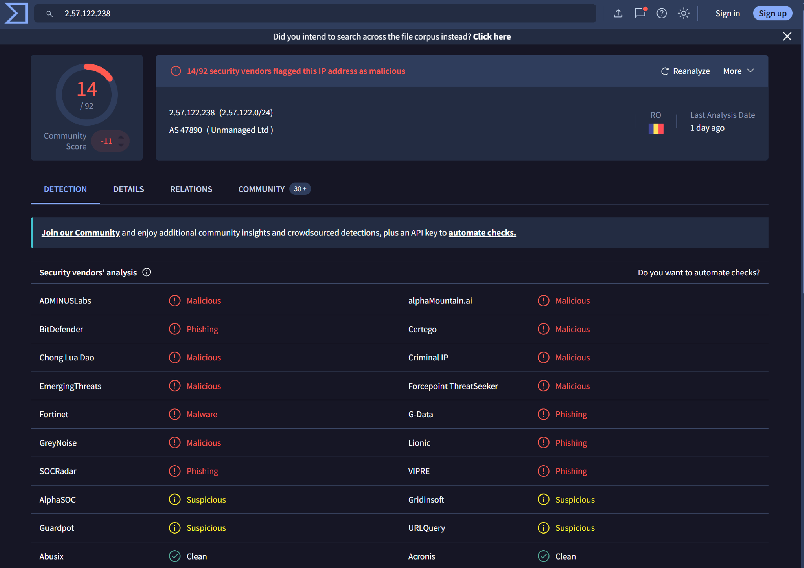
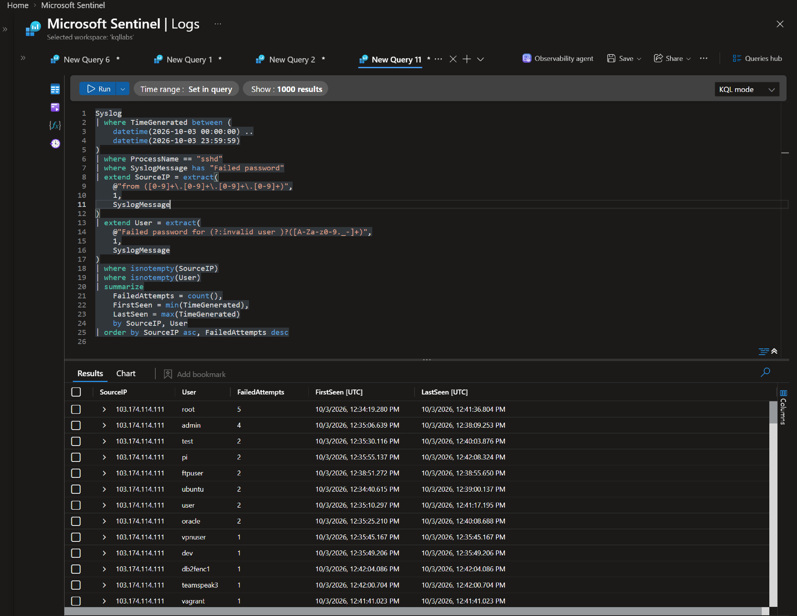

# Case 005: Real SSH Brute-Force Detection — Failed Authentication Attempts from Multiple External Sources
---

## Scenario

This case documents a real-world SSH brute-force detection and investigation involving an Ubuntu virtual machine hosted in Microsoft Azure. On October 3, 2026, Microsoft Sentinel recorded repeated failed SSH authentication attempts originating from multiple external IP addresses while SSH was exposed to the internet through an Azure Network Security Group (NSG) rule allowing inbound TCP/22 traffic from any source.

The investigation focused on identifying the external sources, analyzing targeted usernames and authentication patterns, checking for evidence of successful SSH access, and examining selected host artifacts for indicators of compromise. The activity was investigated using available Sentinel telemetry and host-level evidence. This was not a controlled attack simulation; conclusions are limited to the evidence collected and reviewed.

The investigation correlated:

* OpenSSH (`sshd`) Syslog entries and failed password-authentication events
* Invalid-user messages and authentication failure records
* Source IP addresses and targeted usernames
* Authentication event counts and timestamps
* Microsoft Sentinel / Log Analytics query results
* VirusTotal IP reputation results
* Local SSH authentication logs and failed-login records
* SSH runtime configuration and selected host persistence locations
* Azure NSG exposure and subsequent containment

The case title uses *Password Spraying* as the working incident label. However, the exact password strategy could not be established from the available telemetry. The observed behavior is more conservatively classified as automated SSH password-guessing activity targeting multiple usernames.

## Executive Summary

On October 3, 2026, an Azure-hosted Ubuntu virtual machine recorded **212 failed SSH password-authentication events from five external IP addresses** in the reviewed Microsoft Sentinel / Log Analytics data.

The activity targeted multiple usernames, including common system and application account names such as `root`, `ubuntu`, `admin`, `debian`, `postgres`, `mysql`, `jenkins`, and `deploy`. The pattern was consistent with automated SSH password guessing or opportunistic credential scanning against commonly used usernames.

The available evidence established that multiple usernames were targeted but did not establish how many distinct passwords were attempted, whether the same password was reused across multiple accounts, or whether previously compromised credentials were used. Therefore, the exact password strategy could not be confirmed as password spraying or credential stuffing.

At the time of the activity, inbound TCP/22 was permitted from `Any` in the Azure NSG as part of an FTP laboratory exercise. The effective SSH configuration also had password authentication enabled through `PasswordAuthentication yes`.

After noticing the activity, the investigator restricted inbound SSH access in the NSG to their own public IP address. The exact time of this change was not recorded. SSH password authentication remained enabled after the network-layer containment action.

The investigation included a review of Sentinel authentication events, local SSH authentication logs, failed-login records, SSH runtime configuration, account-modification logs, temporary directories, cron jobs, systemd units, and selected recently modified files.

No successful SSH authentication was identified in the reviewed records for October 3, 2026. The scoped host investigation did not identify suspicious artifacts or persistence mechanisms in the reviewed locations.

However, `auditd` was inactive, and `auditctl` was unavailable. The investigation did not include a complete forensic acquisition of the VM, and the available evidence cannot conclusively exclude every possible form of compromise.

**Conclusion:** The evidence supports an incident involving repeated, likely automated SSH password-guessing attempts against an Azure Ubuntu VM exposed to broad inbound SSH access. No successful SSH authentication or persistence was identified in the reviewed evidence. A successful compromise was not established.

## MITRE ATT&CK Mapping

| Tactic | Technique | Relevance to This Case |
|---|---|---|
| Credential Access | T1110 — Brute Force | Primary classification for repeated failed SSH password-authentication attempts |
| Credential Access | T1110.001 — Password Guessing | Consistent with attempts to authenticate using candidate passwords; the exact password strategy was not established |
| Discovery | T1087 — Account Discovery | Potentially relevant because multiple common usernames were targeted; successful enumeration of valid accounts was not established |

### Technique Assessment

The observed activity involved repeated failed SSH password-authentication attempts from five external IP addresses, targeting numerous usernames. The pattern is consistent with automated SSH credential guessing against common Linux and application account names.

The available logs establish that multiple candidate usernames were used in authentication attempts. They do not establish the number of distinct passwords attempted, whether the same passwords were reused across accounts, or whether previously exposed credentials were used.

For this reason, **T1110 — Brute Force** is the most defensible primary classification. `T1110.001 — Password Guessing` is a plausible sub-technique based on the observed authentication behavior.

`T1087 — Account Discovery` is a potential secondary mapping because the sources attempted authentication with numerous usernames. However, targeting multiple usernames does not, by itself, prove that the attacker successfully identified valid accounts or that account discovery was the primary objective.

`T1110.003 — Password Spraying` and `T1110.004 — Credential Stuffing` are not assigned as confirmed techniques because the available evidence does not establish the defining password strategy or the use of previously exposed credentials.

## Lab Environment

| Component | Value |
|---|---|
| Cloud Provider | Microsoft Azure |
| SIEM / Log Analytics | Microsoft Sentinel / Log Analytics Workspace |
| Telemetry | Linux Syslog / OpenSSH authentication logs |
| Log Collection | Azure Monitor Agent (AMA), as configured in the environment |
| Target Host | `FILE01` |
| Operating System | Ubuntu |
| Relevant User Account | `Neo` |
| Target Service | OpenSSH (`sshd`) |
| Target Port | TCP/22 |
| Initial Network Exposure | Inbound TCP/22 allowed from `Any` in the Azure NSG |
| Authentication Method | SSH password authentication enabled |
| Incident Date | October 3, 2026 |
| Investigation Type | External SSH authentication activity investigation |
| Containment | SSH network access restricted to the investigator's public IP |

## Timeline

| Time (UTC) | Event | Source |
|---|---|---|
| Before detection | Inbound TCP/22 was permitted from `Any` in the Azure NSG during the FTP laboratory exercise. | Investigator-provided configuration context |
| 03 Oct 2026 11:04:24.716–11:04:26.189 | Seven failed password events from `77.239.124.202` and one event from `2.57.122.238` were recorded within the observed interval. | Sentinel query results |
| 03 Oct 2026 12:11:28.569–12:16:51.903 | 81 failed password events were observed from `178.128.57.150`. | Sentinel query results |
| 03 Oct 2026 12:34:19.280–12:42:08.324 | 41 failed password events were observed from `103.174.114.111`. | Sentinel query results |
| 03 Oct 2026 12:42:52.378–12:50:49.751 | 82 failed password events were observed from `162.14.107.96`. | Sentinel query results |
| After detection; exact time unavailable | The investigator restricted inbound SSH access in the Azure NSG to their own public IP address. | Investigator statement |
| After detection; exact date unavailable | The five source IP addresses were checked using VirusTotal. | Investigator-provided results |
| During subsequent investigation | SSH authentication logs, failed-login records, SSH runtime configuration, account changes, temporary directories, cron, systemd, and selected recently modified files were reviewed. | Investigator-provided investigation results |

> **Important:** The Sentinel timestamps listed above are in UTC. The exact timestamp of the NSG change was not recorded in the supplied evidence.

### Authentication Activity Summary

The incident-day Sentinel query returned the following distribution:

| Source IP | Failed Password Events | Distinct Usernames | First Observed (UTC) | Last Observed (UTC) |
|---|---:|---:|---|---|
| `162.14.107.96` | 82 | 43 | 12:42:52.378 | 12:50:49.751 |
| `178.128.57.150` | 81 | 42 | 12:11:28.569 | 12:16:51.903 |
| `103.174.114.111` | 41 | 28 | 12:34:19.280 | 12:42:08.324 |
| `77.239.124.202` | 7 | 5 | 11:04:24.716 | 11:04:26.189 |
| `2.57.122.238` | 1 | 1 | 11:04:26.189 | 11:04:26.189 |
| **Total** | **212** | — | — | — |

The two highest-volume sources generated 163 of the 212 failed password events, approximately 76.9% of the total. The three highest-volume sources generated 204 events.

The targeting of numerous usernames is consistent with automated credential guessing. However, the event counts do not reveal the number of distinct passwords attempted, so they cannot independently distinguish password spraying from other password-guessing strategies.

## Objectives

* Identify repeated failed SSH password-authentication attempts in Microsoft Sentinel
* Determine the number of events associated with each external source IP
* Identify usernames targeted by each source
* Reconstruct the observed authentication timeline
* Search for successful SSH authentication in Sentinel and local logs
* Review historical failed-login records without mixing them with the incident-day event count
* Examine the effective SSH runtime configuration
* Review selected host locations for suspicious artifacts and persistence
* Enrich observed source IP addresses with VirusTotal reputation data
* Document the initial network exposure and subsequent containment
* Map the observed behavior to MITRE ATT&CK without overstating the evidence
* Document telemetry limitations and provide evidence-based remediation recommendations

  ## Investigation

### Identify External SSH Sources

#### KQL Query

[01-authentication-evidence.kql](./queries/01-authentication-evidence.kql)

Purpose
This establishes the raw SSH authentication timeline.
Why this comes first
A single Failed password does not prove brute force.
You first need to confirm that:
the event is generated by sshd;
it occurred on the target host;
authentication actually failed;
the activity is temporally clustered.
What you are looking for
Examples:
Failed password for root from x.x.x.x
Invalid user admin from x.x.x.x
pam_unix(sshd:auth): authentication failure

### Identify External Source IPs

Once you know the activity exists, determine who was generating it.

#### KQL Query

[02-external-source-ips.kql](./queries/02-external-source-ips.kql)

Purpose
This answers:
Which source IPs are responsible for the SSH authentication failures?

### Verify IPs by VirusTotal

## Executive Summary
В ходе анализа 5 внешних IP-адресов на платформе VirusTotal была выявлена вредоносная и подозрительная активность различной степени риска. Наблюдаемые адреса ассоциированы с фишингом, распространением вредоносного ПО (Malware) и сканированием/активностью вредоносных узлов.

## Mitigation Steps)

Сетевая блокировка: Внести адреса 2.57.122.238, 77.239.124.202 и 178.128.57.150 в правила блокировки на межсетевых экранах (FW) и NIDS/NIPS.   

Проверка логов (Threat Hunting): Выполнить поиск по SIEM/proxy-логам за последние 30 дней на предмет входящих и исходящих соединений с указанными IP-адресами.

### Determine How Many Accounts Each Source Targeted

This is where you distinguish a simple repeated password attack from multi-account automated enumeration.

#### KQL Query

[03-determine-how-many-accounts-each-source-targeted.kql](./queries/03-determine-how-many-accounts-each-source-targeted.kql)

Purpose
This answers:
Is the source attacking one account repeatedly, or cycling through many usernames?

### Build the Source → Username → Attempt Matrix

This is one of the most useful evidence tables for the final report.

#### KQL Query

[04-build-the-source -username -attempt-matrix.kql](./queries/04-build-the-source -username -attempt-matrix.kql)

Purpose
This gives you the exact relationship:
Source IP → Username → Number of failed password attempts

account root is the main leader in the number of attempts

### Investigate the Most Important Username: root

For Linux attacks, root deserves its own pivot.

#### KQL Query

[05-investigate-username-root.kql](./queries/05-investigate-username-root.kql)

[11-investigate-username-root.png](./screenshots/11-investigate-username-root.png)

Purpose
This determines:
whether root was targeted;
how often;
by which source IPs;
at what times.

#### Check for Successful Authentication

#### KQL Query

[06-successful-authentication.kql](./queries/06-successful-authentication.kql)

[13-successful-authentication.png](./screenshots/13-successful-authentication.png)

Purpose
This looks specifically for successful SSH authentication.

The query returned no results.
Therefore:
No successful SSH authentication was observed in the reviewed Sentinel telemetry.
That is a finding, not a statement that compromise was impossible.

Если подтверждён факт успешной компрометации (Successful Authentication после серии Brute Force), порядок первых секунд выглядит так:
Первые 3 шага (В течение 1–2 минут):
Блокировка IP-адреса на сетевом уровне (Azure NSG / Firewall / iptables):
Зачем: Перекрывает нападающему канал связи с вашей виртуальной машиной, чтобы он не успел передать команды, скачать новые скрипты или установить Reverse Shell.
Завершение активных сессий (Kill Sessions) и блокировка учетной записи:
Зачем: Если атакующий уже находится внутри консоли (SSH-сессия активна), сам по себе блок IP или смена пароля не сбросит текущую открытую сессию bash. Нужно принудительно «убить» процесс входа (pkill -u USER -9) и заблокировать учетку (usermod -L USER).
Сброс учётных данных (Credential Reset):
Зачем: Сменить пароль и отозвать все действующие токены/сессии, чтобы исключить возможность повторного входа.

### Validate the Same Findings Directly on the Endpoint

Because your /var/log/auth.log generated:
grep: binary file matches

bash
sudo grep -a '2026-10-03' /var/log/auth.log | \
grep -E 'sshd|Failed password|Invalid user|authentication failure'

no result 

Purpose
This provides endpoint-side confirmation of what Sentinel received.
You want the evidence chain to be:
FILE01
  ↓
auth.log
  ↓
rsyslog/Syslog
  ↓
AMA
  ↓
Log Analytics
  ↓
Sentinel

If the same attack appears at both the endpoint and SIEM levels, your telemetry correlation is stronger.

## login and IP address for all types of unsuccessful attempts, and sort them by count:

bash
sudo journalctl -u ssh --since '2026-10-03 00:00:00' --until '2026-10-03 23:59:59' --no-pager | grep -E 'Failed password|Invalid user' | sed -n -e 's/.*Failed password for invalid user .* from [0-9.]*.*/\2 \1/p' -e 's/.*Failed password for .* from [0-9.]*.*/\2 \1/p' -e 's/.*Invalid user .* from [0-9.]*.*/\2 \1/p' | sort | uniq -c | sort -nr | head -100

[15-unsuccessful-attempts (1).png](./screenshots/15-unsuccessful-attempts (1).png)

Основные векторы атаки (Словарный перебор):
root и ubuntu — абсолютные лидеры по количеству попыток от обоих главных атакующих узлов (162.14.107.96 и 178.128.57.150).
deploy, test, admin, user — стандартные сервисные и административные имена.
postgres, oracle, ubnt — специализированные сервисные учетные записи для баз данных и сетевого оборудования Ubiquiti.
Сравнение источников:
IP 162.14.107.96 и 178.128.57.150 действовали практически с зеркальной интенсивностью (по 20 попыток под root, по 16 под ubuntu, по 10 под deploy). Это характерно для работы одного и того же ботнета, распределяющего словарь по разным узлам.
IP 103.174.114.111 сфокусировался в первую очередь на admin (8) и root (5).

Данные с локального сервера полностью совпадают с тем, что собрал Azure Monitor Agent (AMA) и отобразил KQL-запрос в Sentinel. Это подтверждает, что телеметрия между FILE01 и вашей SIEM-системой ходит без потерь. 

### Validate Successful SSH Authentication Locally

bash
sudo grep -a '2026-10-03' /var/log/auth.log | \
grep -E 'Accepted password|Accepted publickey'

sudo journalctl -u ssh --since '2026-10-03 00:00:00' --until '2026-10-03 23:59:59' --no-pager | grep -i 'accepted'

Purpose
This is the endpoint equivalent of the Sentinel success check.
result:
No output.
That gives you two independent findings:
No successful SSH authentication was observed in Sentinel.
and:
No successful SSH authentication was identified in the local auth.log during the reviewed date.

### Check Failed Login History With lastb
Bash
sudo lastb -ai | head -1000

sudo lastb -i | awk '{print $3, $1}' | sort | uniq -c | sort -nr | head -1000

[16-ip-and-user-rating.png](./screenshots/16-ip-and-user-rating.png)

Важная деталь из вашего вывода lastb:
Обратите внимание на нижнюю часть списка:
Новые IP-адреса и более ранняя дата:
В логе отобразились события за 30 сентября 2026 года (Wed Sep 30):
77.239.124.202 — перебор учеток yellow, dev, debian, samir, appuser, openhabian и др.
2.57.122.238 — перебор учеток ethdocker, solana, sol.
Подтверждение непрерывности атак:
Это доказывает, что сервер подвергался автоматическому сканированию не только 3 октября, но и за несколько дней до этого. Ботнеты регулярно опрашивают ваш публичный IP.

Основной инцидент (Primary Incident Under Investigation)
Дата: 3 октября 2026 года.
Фокус: Атака от IP-адресов 162.14.107.96 и 178.128.57.150.
Доказательная база: Данные KQL из Azure Sentinel + посекундный разбор journalctl.
2. Исторический контекст и угрозы (Threat Intelligence & Historical Baseline)
Источник данных: Извлечение бинарного лога /var/log/btmp через lastb.
Находки: Выявление более масштабной непрерывной активности с подсетей, таких как 77.239.124.0/24 (где 77.239.124.151 совершил 375+ попыток подбора root).
Аналитический вывод: Сервер подгадывается автоматизированными ботнетами на постоянной основе. Атака 3 октября была лишь частью общего фона (Internet Background Noise / Automated Reconnaissance).
Почему включение lastb делает ваш отчет ценным:
Показывает системный подход: Вы не просто посмотрели один файл за один день, а проверили исторические данные хоста и бинарные логи (btmp).
Дает основу для рекомендаций (Remediation): Вы можете предложить не просто заблокировать пару IP за 3 октября, а внести в правила Firewall / NSG всю вредоносную подсеть 77.239.124.0/24 и настроить Fail2ban / SSH Key-Based Authentication.

### Check Successful Login History

Bash
sudo last -ai | head -50

[17-successful-login-history (1).png](./screenshots/17-successful-login-history (1).png)

Purpose
This checks successful login sessions.

lastb (/var/log/btmp): Фиксирует массивный поток неудачных попыток подбора паролей (Brute Force Attempts).
journalctl / auth.log: Дает посекундную детализацию атаки, используемые словари и подтверждает статус Failed password / preauth.
last (/var/log/wtmp): Окончательно подтверждает отсутствие успешных входов (Accepted) и дает точные интервалы работы хоста (system boot).

### Check Temporary Directories
Bash
ls -la /tmp /var/tmp /dev/shm

screen 18-temporary-directories

Then:
sudo find /tmp /var/tmp /dev/shm \
  -mtime -3 -ls 2>/dev/null

Artifact Inspection Verdict:
Examination of non-persistent staging directories (/tmp, /var/tmp, /dev/shm) revealed no malicious artifacts, web shells, or dropped payloads. All identified entries strictly correlate with standard Ubuntu systemd service sandboxes (PrivateTmp), X11 IPC sockets, and Azure cloud-init processes.

Correct conclusion
Do not write:
No malicious files existed on the host.
Write:
No suspicious artifacts were identified in /tmp, /var/tmp, or /dev/shm during the reviewed period.

### Check for Account Creation or Modification

sudo grep -a -E \
'useradd|usermod|userdel|passwd|groupadd|gpasswd' \
/var/log/auth.log

Account & Group Modification Audit:
Analysis of /var/log/auth.log for administrative user/group management commands (useradd, usermod, userdel, passwd, groupadd) yielded zero unexpected modifications. No local accounts, group privileges, or password changes were executed around or following the October 3 attack window.

### Check systemd Persistence
Bash
systemctl list-unit-files --state=enabled

Then:
systemctl --failed

Check locally created service definitions:
sudo find /etc/systemd/system \
  -type f \
  -maxdepth 3 \
  -ls

[20-systemd-persistence (1).png](./screenshots/20-systemd-persistence (1).png)

Purpose
Attackers can establish persistence through malicious systemd services or timers.
Look for
Unexpected services executing:
/bin/bash
/bin/sh
curl
wget
python
perl
nc
socat

or binaries located in:
/tmp
/var/tmp
/dev/shm
/home/…

### Check SSH Configuration

Bash
sudo sshd -T | \
egrep 'port|permitrootlogin|passwordauthentication|pubkeyauthentication|maxauthtries|logingracetime|allowusers|allowgroups'

[21-ssh-configuration (1).png](./screenshots/21-ssh-configuration (1).png)

Purpose
This answers:
Was SSH exposed?
Was password authentication enabled?
Was root login permitted?
How many authentication retries were allowed?
Were access restrictions configured?
Why this matters
Your incident needs an explanation of why the attacker could reach the service.
For example:
Internet
   ↓
TCP/22 exposed
   ↓
sshd
   ↓
Password authentication
   ↓
Repeated credential attempts

This becomes part of your root-cause analysis.

Анализ конфигурации sshd:
passwordauthentication yes + port 22 — Основная уязвимость вектора атаки. Стандартный порт SSH был открыт в интернет через NSG, а парольная аутентификация разрешена. Это сделало хост мишенью для автоматизированных сканеров ботнетов.
permitrootlogin without-password — Главный защитный барьер по умолчанию. Прямой вход под root по паролю запрещен на уровне SSH-демона (разрешен только по ключам). Все ~600+ попыток атакующих подобрать пароль к учетке root были изначально обречены на сбой еще до стадии проверки пароля.
maxauthtries 6 & logingracetime 120 — Дефолтные лимиты сессии (6 попыток на одно TCP-соединение, таймаут 2 минуты).
Точная формулировка для отчета:
SSH Configuration & Root Cause Analysis:
Audit of active SSH runtime parameters (sshd -T) identified the attack vector: passwordauthentication yes exposed on default port 22. However, brute-force attempts targeting the primary account (root) were mitigated at the protocol layer by permitrootlogin without-password, which restricts root access strictly to public key authentication.

### Investigation Summary

The investigation identified 212 failed SSH password-authentication events from five external source IP addresses on October 3, 2026. The attempts targeted multiple usernames, including common administrative and service account names.

The reviewed Microsoft Sentinel results and host-level authentication records did not reveal successful SSH authentication. The examined SSH configuration, temporary directories, scheduled tasks, systemd services, and selected filesystem locations did not identify clear evidence of post-exploitation activity.

These findings do not establish that the host was compromised. However, the absence of successful authentication events in the reviewed telemetry does not conclusively prove that access was never obtained. The assessment is limited to the available logs and the host artifacts examined during the investigation.

